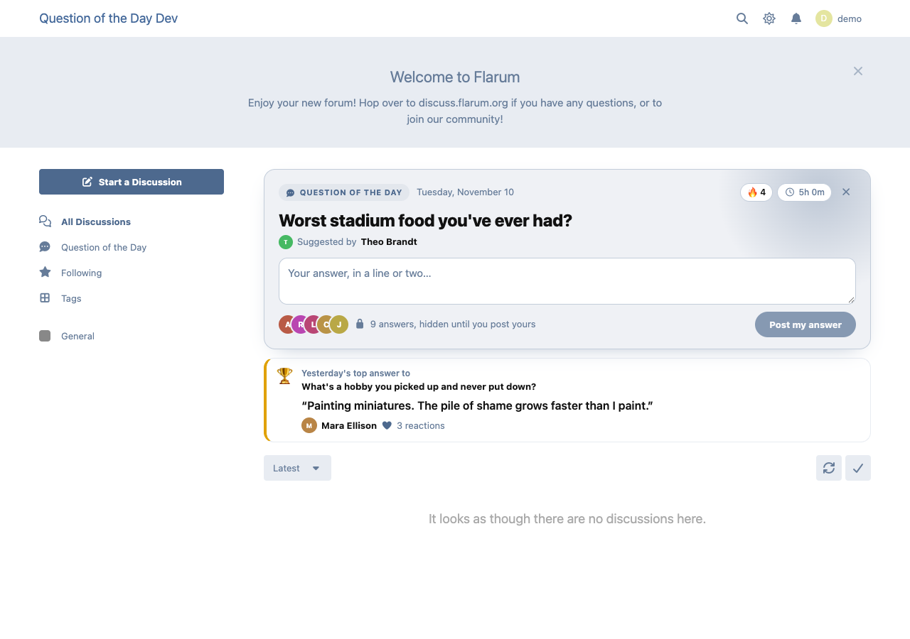
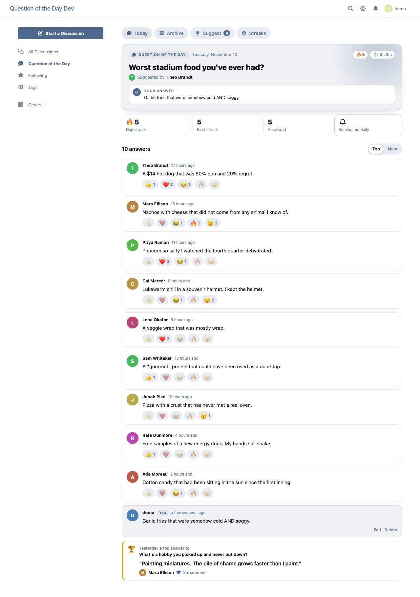
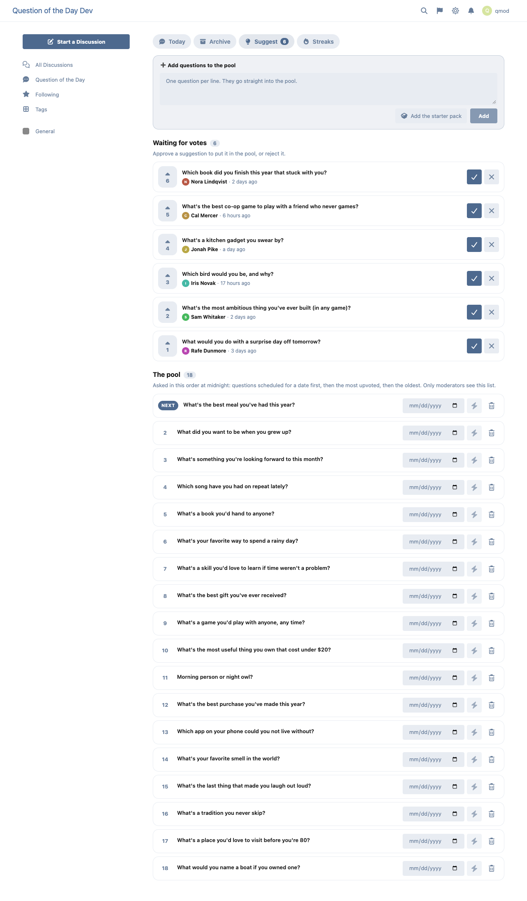

# Question of the Day

[](https://packagist.org/packages/ernestdefoe/question-of-the-day)
[](LICENSE)

A [Flarum 2](https://flarum.org) extension that gives your forum one question a day, right on the front page. Members answer in a line or two, and **everyone else's answers stay hidden until you post yours**. Then the answers open up, people react to the best ones, and tomorrow's card features yesterday's top answer.



## What members get

- **A card on the front page** with today's question, a box to answer it, and how many members already have (their faces, not their words). Once you answer, the card shows the three best answers so far and a link to the rest.
- **Answers unlock when you post yours.** The server refuses to send anyone else's answer until you've posted your own, so there's no peeking, even through the API.
- **Reactions** (👍 ❤️ 😂 🔥 😮) on other people's answers, sorted by Top or New.
- **Yesterday's top answer** on today's card: the one with the most reactions when the day closed.
- **Streaks**: answer the next question and your streak grows. A day the pool ran dry doesn't break it. There's a board for who's on a roll and the longest streaks ever.
- **An archive** of every past question with all its answers and its winner.
- **Suggest questions** and upvote other members' suggestions. Moderators approve the good ones into the pool, and the most upvoted go first.
- **A daily reminder**: members who switch it on get an alert when a new question goes up, and the member who suggested a question hears when it's picked.



## What admins and moderators get

- **A new question at local midnight**, in the timezone you choose. The scheduler picks the next one from the pool: anything scheduled for that day first, then the most upvoted, then the oldest.
- **The pool**, visible only to moderators: add questions one per line, add a 60-question starter pack in one click, schedule a question for a date, or ask one right now (it replaces today's if nobody has answered it yet).
- **The queue**: approve or reject members' suggestions.
- **Moderate answers**: open today's answers without answering, and delete any answer.
- **Optional daily discussion**: each question can also start a discussion (posted as a member you choose, in a tag you choose) for open conversation.
- Permissions for viewing, answering, suggesting and moderating.



## Installation

```sh
composer require ernestdefoe/question-of-the-day
php flarum migrate
php flarum cache:clear
```

Then enable **Question of the Day** in the admin panel, set your timezone, and add some questions (or the starter pack) from **Question of the Day → Suggest** on the forum.

New questions go up when the Flarum scheduler runs (`php flarum schedule:run` every minute from cron). Without a scheduler, the next visit after midnight puts the question up instead; reminders and the daily discussion then follow from your queue worker, or straight away if you have none.

## Updating

```sh
composer update ernestdefoe/question-of-the-day
php flarum migrate
php flarum cache:clear
```

## Privacy

Answers are only ever sent to members who answered the same question (or to moderators who open it to moderate) until the next question replaces it; then they become part of the public archive for anyone who can view questions. With [flarum/gdpr](https://github.com/flarum/gdpr) enabled, a member's answers, suggestions and streak are in their data export, and erasing an account removes their answers, reactions and votes.

## Links

- [Packagist](https://packagist.org/packages/ernestdefoe/question-of-the-day)
- [GitHub](https://github.com/ernestdefoe/question-of-the-day)
- [Try it on the showcase forum](https://ernestdefoe.dev/question)

If this extension makes your forum a little busier every day, you can [buy me a coffee](https://buymeacoffee.com/ernestdefoe). ☕
